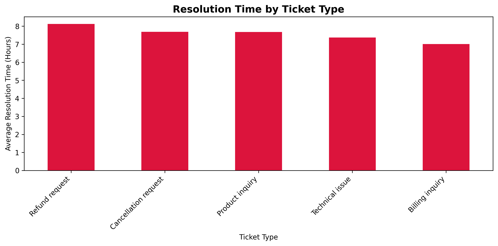
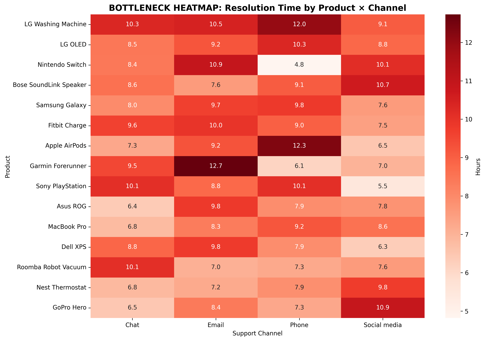

# Customer Support Bottleneck Analysis

Where do support tickets slow down, and does speed actually move customer satisfaction? An operations analysis of 8,469 support tickets by product, channel and ticket type, written from a CX Ops point of view.

**Tools**: Python, pandas, Matplotlib, seaborn, Jupyter
**Skills**: data cleaning, data-quality assessment, EDA, business analysis, data visualization

---

## Dataset

- **Source**: [Customer Support Ticket Dataset](https://www.kaggle.com/datasets/suraj520/customer-support-ticket-dataset) (Kaggle, synthetic)
- **Raw**: 8,469 tickets, 17 columns
- **Analysed**: 1,404 closed tickets with a valid resolution time

| Step | Tickets |
|---|---|
| All tickets | 8,469 |
| Closed only (open and pending have no resolution time) | 2,769 |
| Resolution timestamp after first response (data-quality filter) | **1,404** |

Half of the closed tickets record a resolution *before* the first response. They were removed rather than corrected, because there is no reliable way to repair them.

---

## Key Findings

**Baseline**: 7.58 h average resolution (median 6.34 h), satisfaction 3.03 / 5.

**1. Refund requests are the slowest and least satisfied ticket type**
- 8.12 h average across 304 tickets, against 7.01 h for billing inquiries (the fastest type)
- Satisfaction 2.90 / 5, joint lowest with technical issues (2.89)
- Refunds and cancellations together make up 569 of the 1,404 tickets (41%), the ones closest to revenue

**2. Product drives more variation than channel**
- Among the 15 slowest products, averages run from 10.23 h (LG Washing Machine) to 8.11 h (GoPro Hero): a 2.1 h spread
- Channel averages sit within 0.65 h of each other: Social media 7.91 h, Email 7.62 h, Chat 7.50 h, Phone 7.26 h
- Worst product-channel combinations: Garmin Forerunner via Email (12.73 h), Apple AirPods via Phone (12.31 h), LG Washing Machine via Phone (11.98 h)

**3. Resolution speed does not explain satisfaction in this data**
- Correlation between resolution hours and satisfaction: **-0.004** (no relationship)
- Faster support alone will not raise CSAT here; satisfaction is driven by something the dataset does not capture, such as outcome quality or the issue itself
- This is the most important result for prioritisation: it argues against investing in speed alone




---

## Recommendations

| Horizon | Action | Why |
|---|---|---|
| Week 1 | Separate queue and SLA for refund and cancellation tickets | Slowest type, lowest satisfaction, closest to revenue |
| 1-3 months | Route by product, not only by channel (e.g. AirPods to Chat, Garmin away from Email) | Product explains more variation than channel |
| 1-3 months | Product-specific troubleshooting guides for the slowest products | LG Washing Machine and LG OLED lead resolution time |
| 1-2 quarters | Add outcome tracking (resolved first time, refund granted, churned after ticket) | Speed does not predict satisfaction; outcome data is needed to find what does |

---

## Limitations

- **Synthetic data**: resolution texts and descriptions are generated, so findings show the method rather than describe a real company
- **No revenue or churn fields**: the impact on NRR and revenue cannot be measured from this dataset, only argued from ticket type
- **Small cells**: product-channel combinations hold roughly 5-15 tickets each, so treat the "worst combination" figures as leads to check, not conclusions
- **Expected improvements are targets, not results**: e.g. a refund SLA under 4 hours would cut the refund average by about half if it were met

---

## Run it (Windows PowerShell)

```
git clone https://github.com/erikroa/SaaS-Support-Ticket-Analysis-View.git
cd SaaS-Support-Ticket-Analysis-View
python -m venv .venv
.\.venv\Scripts\Activate.ps1
pip install kagglehub pandas numpy matplotlib seaborn jupyterlab
jupyter lab final_analysis.ipynb
```

---

**Author**: Erik Roa | [LinkedIn](https://linkedin.com/in/erikroa) | [GitHub](https://github.com/erikroa)
